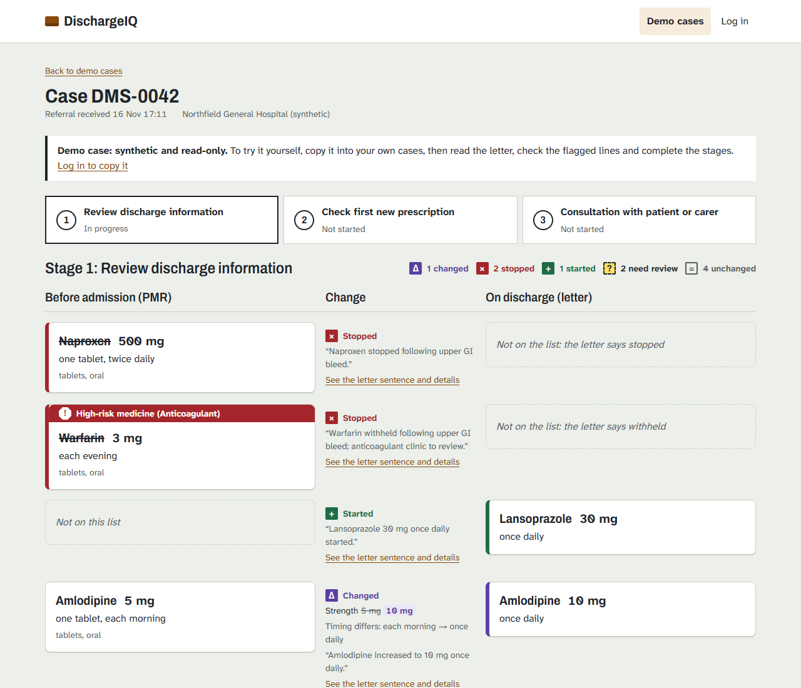
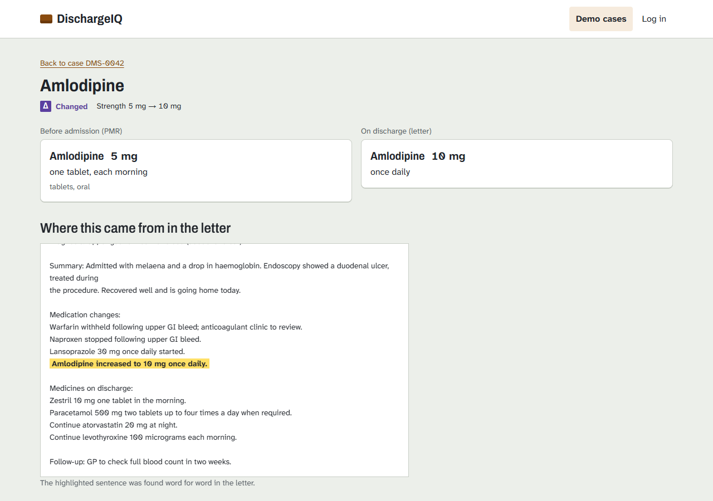
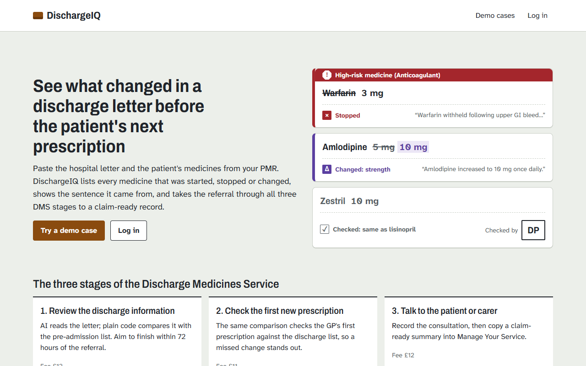
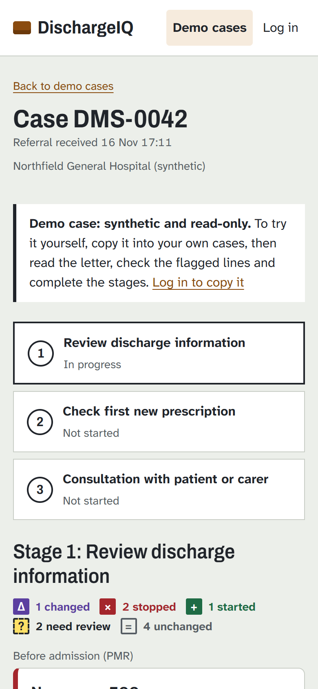
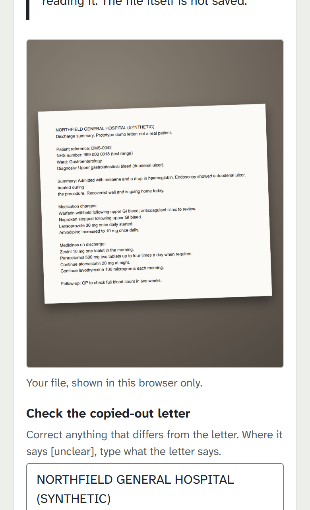

# DischargeIQ

Helps community pharmacy teams complete **NHS Discharge Medicines Service (DMS)** referrals, from the safety check
to a claim-ready record. AI reads the hospital discharge letter; plain, tested code compares it with the patient's
medicines before admission (started / stopped / changed / unchanged), with every line linked to the exact sentence
in the letter; the pharmacist checks and approves each of the three DMS stages.

> **Prototype for a bootcamp final project. Synthetic data only. Not a medical device.**
> It supports the pharmacist's decision; it never makes one.

**Why:** in user research, comparing a discharge letter with the patient's medication record took pharmacists
15–20 minutes per referral, and one pharmacist submitted no DMS claims at all (worth up to £35 each) because the
claim process was too convoluted.

## Live
- **App:** https://dischargeiq-pied.vercel.app (try **Demo cases**: no account needed)
- **API docs (Swagger):** https://dischargeiq-pied.vercel.app/api/docs (OpenAPI file: `/api/docs.json`)
- **API health:** https://dischargeiq-api-nr30.onrender.com/api/health

An uptime monitor calls `/api/health` every 5 minutes, which keeps the free API host and database awake.

## Screenshots

| The comparison (desktop) | Where each line came from |
|---|---|
|  |  |

| Home | The comparison on a phone | Checking an uploaded letter |
|---|---|---|
|  |  |  |

## What it does
1. **Case:** the pharmacist creates a case with a pseudonymous reference (never a name) and types in the
   medicines from the patient's record (PMR).
2. **Letter:** paste the discharge letter, or **upload a PDF or photo**: the AI copies it out as text, writes
   `[unclear]` instead of guessing, and the pharmacist checks the text before it is used.
3. **AI reads:** Claude lists the discharge medicines and quotes the sentence each came from. The answer is checked
   with a Zod schema, and any quoted sentence not found word for word in the letter is flagged.
4. **Code compares:** a deterministic engine (no AI) labels every line STARTED / STOPPED / CHANGED / UNCHANGED.
   Anything uncertain (possible brand/generic match, dose written differently, missing strength) is flagged
   **Needs review**; high-risk medicines (anticoagulants, insulin, opioids…) are flagged from a hand-written rules list.
5. **Pharmacist approves:** a stage can't be completed until every flagged line has been checked (enforced on the
   server). Stage 2 re-uses the same engine to check the first new prescription against the discharge list.
6. **Claim:** once the stages are done, a claim-ready summary with copy buttons and a "claim by" date, plus a claims
   and stats page.

Safety controls: a real (non-test) NHS number is refused anywhere in the app; users can only see their own cases;
errors never show internal details. See [`docs/hazard-log.md`](docs/hazard-log.md).

## Tech stack
| Part | Choice |
|---|---|
| Language | TypeScript everywhere (strict), one npm workspace for `client`, `server` and `shared` |
| Front end | React + Vite + React Router, plain CSS + CSS Modules with design tokens |
| API | Node.js + Express 5, REST JSON under `/api`, layered routes → controllers → services → db |
| Database | PostgreSQL on Supabase (London), plain parameterised SQL with `pg`, numbered `.sql` migrations |
| Validation | Zod schemas in `shared/`, used by the browser, the API and to check every AI answer |
| Auth | Own: bcrypt password hashes + JWT in an `HttpOnly; Secure; SameSite=Lax` cookie |
| AI | Anthropic Claude API, called only from the server; demo mode without a key |
| Tests | Vitest + Supertest against a real Postgres (196 tests); Lighthouse + axe for accessibility |
| Hosting | Vercel (client; forwards `/api/*` to the API) + Render (API, Frankfurt) + Supabase (database) |
| CI | GitHub Actions on every push: typecheck → lint → test → build |

Why each choice was made: [`docs/architecture.md`](docs/architecture.md) and the decision log
[`docs/decisions.md`](docs/decisions.md).

## Run it locally
Requires **Node 24** (see `.nvmrc`) and two PostgreSQL databases: a main one and a separate, throwaway one for
tests (a free Supabase project or a local Postgres both work).

```bash
npm install

# Create the two .env files from the examples, then fill in the values:
cp server/.env.example server/.env        # Windows: copy server\.env.example server\.env
cp client/.env.example client/.env        # Windows: copy client\.env.example client\.env

npm run migrate      # create the tables in DATABASE_URL
npm run seed         # add the synthetic demo cases

npm run dev:server   # terminal 1: API on http://localhost:3000
npm run dev:client   # terminal 2: app on http://localhost:5173 (forwards /api to the API)
```

Without `ANTHROPIC_API_KEY` the app runs in **demo mode**: the letter reader recognises the synthetic demo letters
and the sample upload files in `client/public/demo-letters/`; any other letter needs its medicines added by hand.

### Environment variables (names only; values never go in git)
| File | Name | What it is |
|---|---|---|
| `server/.env` | `DATABASE_URL` | Main database (Supabase **session pooler** connection string) |
| | `TEST_DATABASE_URL` | A separate database for `npm test` (the tests refuse to run against the main one) |
| | `DATABASE_SSL` | `verify` (default: check Supabase's certificate) or `off` (local/CI Postgres only) |
| | `JWT_SECRET` | Random secret, at least 32 characters, that signs login tokens |
| | `ANTHROPIC_API_KEY` | Claude API key. Leave empty for demo mode |
| | `ANTHROPIC_MODEL` | Optional model name (default `claude-opus-5-5`) |
| | `PORT` | Optional (default 3000; Render sets it) |
| `client/.env` | `API_PROXY_TARGET` | Development only: where Vite forwards `/api` (e.g. the local API). Not a secret |

Generate `JWT_SECRET` in a separate terminal (it must never be pasted into a chat or committed), e.g.
`node -e "console.log(require('crypto').randomBytes(48).toString('base64'))"`.

## Tests and checks
| Command | What it does |
|---|---|
| `npm test` | All server tests (reconciliation engine, auth, ownership on every route, stages, uploads, errors) against `TEST_DATABASE_URL` |
| `npm run typecheck` | TypeScript check of all three packages |
| `npm run lint` | ESLint |
| `npm run build` | Builds the API (`tsup`) and the client (`vite build`) |

CI runs all four on every push with a throwaway Postgres container. Live end-to-end, accessibility and
colour-vision results are in [`docs/test-sheet.md`](docs/test-sheet.md).

## Project structure
```
shared/   Zod schemas + types used by client and server (NHS number guard, cases, stages, extraction, upload)
client/   React app: src/pages (one file per page), src/components, src/api (fetch wrappers), src/styles
server/   Express API: routes → controllers → services → db; middleware (auth, ownership, errors, rate limits);
          db/migrations (*.sql), db/demoCases.ts (synthetic demo data); tests/
docs/     Brief, architecture, decisions, design system, page designs, hazard log, test sheet, guides
```

## Documentation
- [Client guide](docs/client-guide.md): how a pharmacist uses the app
- [Developer handover](docs/developer-handover.md): deploying, migrations, known limitations
- [Architecture](docs/architecture.md) · [Decision log](docs/decisions.md) · [Hazard log](docs/hazard-log.md)
- [Design system](docs/design-system.md) · [Page designs](docs/designs/) · [User research](docs/user-research.md)
- [Test sheet](docs/test-sheet.md) · [AI usage log](docs/ai-usage-log.md) · [Requirements checklist](docs/requirements-checklist.md)
