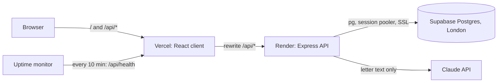
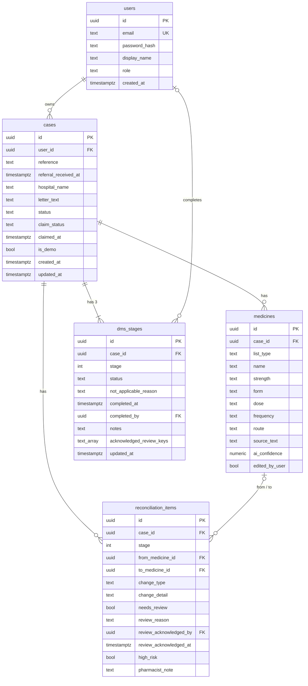

# Architecture — DischargeIQ (working title)

*Status: v0.3 (16 Nov 2026). Updated with the owner's decisions on the expert review
(`consult-review.md` → `decisions.md` D-016 to D-032). Will be updated again at the end of the sprint so it
matches what was built. Log every change in `decisions.md`.*

**Timeline:** planned from 3 Nov 2026; built in a two-day sprint, Mon 16 – Tue 17 Nov (about 30 working
hours, feature freeze Tue 22:00); submitted Wed 18 Nov by 08:30.

## 1. System overview

```
                 Browser (one origin: the Vercel URL)
                        |  HTTPS, JSON, first-party HttpOnly cookie
                        v
[ Vercel: React + TypeScript client ]  --- rewrite /api/* --->  [ Render: Express + TypeScript API ]
                                                                    |            \
                                                pg, session pooler  |             \--> Claude API (extraction only,
                                                (IPv4, SSL)         v                  key on server)
                                          [ Supabase: PostgreSQL (London) ]
                                          RLS deny-all; no browser access

[ shared/ ]  Zod schemas + inferred types, used by client AND server
```

**Why the `/api` rewrite (D-024):** Vercel and Render are different sites. If the browser called Render
directly, the login cookie would be a third-party cookie, which Safari (and increasingly Chrome) blocks.
With the rewrite the browser only ever talks to the Vercel origin, so the cookie is first-party
(`HttpOnly; Secure; SameSite=Lax`), CORS mostly disappears, and the client only uses relative `/api/...` URLs.



**Core principle — "AI reads, code compares, pharmacist approves":**
1. **Extract (AI):** Claude turns letter text into structured JSON medicine lines, each with the
   exact source sentence. Output is validated with Zod.
2. **Compare (deterministic code):** `reconcile.service` compares any two medicine lists and labels each line
   STARTED / STOPPED / CHANGED / UNCHANGED. Lines it can't pair or resolve with certainty are marked
   **needs review**. No AI in this step; fully unit-tested. Used twice: pre-admission vs discharge (stage 1),
   and discharge vs first new prescription (stage 2).
3. **Flag (deterministic rules):** `highrisk.service` applies an owner-written rules list (e.g. anticoagulants,
   lithium, methotrexate, insulin, opioids). For the sprint the rules live in a code file; an admin-managed
   table is a later step.
4. **Approve (human):** the pharmacist reviews, edits if needed, and completes each stage (or marks it
   not applicable, with a reason).
5. **Claim:** `claim.service` builds a claim-ready summary once every applicable stage is complete.

## 2. The DMS workflow the app follows
| DMS stage | Pharmacist task | What the app does | Fee* |
|---|---|---|---|
| 1 | Review discharge information (target: within 72 hours of referral) | AI extraction + comparison vs pre-admission list; 72-hour indicator from `referral_received_at` (guidance, not a hard deadline) | £12 |
| 2 | Check the first new prescription after discharge | Same engine compares new prescription vs discharge list; flags mismatches | £11 |
| 3 | Consultation with the patient or carer | Checklist + notes | £12 |
| — | Claim on NHSBSA Manage Your Service (MYS) | Claim-ready summary with copy buttons and a "claim by" date; claims dashboard | £35 total |

*Fees per Community Pharmacy England (checked Nov 2026). Verify before presenting.

- Each stage has a status: `pending`, `completed` or `not_applicable` (with a reason, e.g. readmitted,
  declined, no new prescription received). Stages need not be completed in strict order.
- **Claim-ready rule (D-021):** no stage is `pending` and stage 1 is `completed`.
- **To verify before the demo:** whether MYS pays and claims per completed stage, and which fields the
  current (July 2025 shortened) MYS DMS claim journey asks for.

## 3. Tech stack and why

| Layer | Choice | Why | Alternatives considered |
|---|---|---|---|
| Language | TypeScript, strict, with simplicity rules (D-007, D-016) | Type checker is a second reviewer for AI-written code; one shared definition of the data | JavaScript (easier start, more runtime bugs) |
| Repo | npm workspaces: `client`, `server`, `shared`; ESM; server bundled with `tsup` (D-019) | One place for shared Zod schemas; avoids tsc/ESM monorepo traps | Separate repos (duplicated schemas) |
| Frontend | React + Vite | Taught on bootcamp, matches TFS example, component reuse | Plain HTML/JS (too manual), Next.js (more to learn), Astro (built for content sites) |
| Styling | Plain CSS + CSS Modules + `tokens.css` (D-025) | Fully explainable; scoped class names with no new syntax; native accessible HTML | Tailwind + shadcn/ui (a lot of hidden code to explain) |
| Backend | Node + Express | Same language as frontend, simple REST, keeps AI key server-side | Python/FastAPI (second language) |
| Database | Supabase PostgreSQL (London) via `pg` + IPv4 session pooler (D-008, D-017) | Standard Postgres (portable); UK data residency; pooler works from Render (direct connection is IPv6-only) | Neon; `supabase-js` + service-role key (a "god key" with no benefit) |
| Data access | Plain parameterised SQL + own `migrate.ts` with numbered `.sql` files (D-018) | Most explainable; no ORM API to learn; injection-safe | Kysely, Drizzle, Prisma; node-pg-migrate, Supabase CLI |
| Auth | Own: bcrypt + JWT in a first-party `HttpOnly; Secure; SameSite=Lax` cookie | Explainable; matches "own API" brief; production would swap to NHS CIS2 | Supabase Auth / Auth0 |
| AI | Claude API (backend only), model name in env var | Strong text extraction, structured output | Local LLM (can't run on free hosting, less accurate) |
| Validation | Zod (in `shared/`) | Same schema guards requests, AI output and front-end forms | Manual checks |
| Tests | Vitest + Supertest against real Postgres (CI service container); engine as pure unit tests; Lighthouse + axe | Ownership bugs live in SQL, so test against a real database | Mocked database; Jest |
| Hosting | Vercel (client) + Render (API, Frankfurt: no London region, D-039) + Supabase (DB, London), `/api` rewrite (D-024) | Free tiers, auto-deploy from GitHub; same-origin cookies | Netlify; Google Cloud Run (about half a day of setup; later) |
| CI/CD | GitHub Actions + host auto-deploy after CI passes (D-012, D-020) | Every change checked; a red build never goes live | Manual deploys |
| Diagrams | Mermaid in `docs/` (D-028) | Version-controlled, rendered by GitHub | draw.io only (one diagram for slides) |

## 4. Data model

**users**
- `id` PK, `email` (unique), `password_hash`, `display_name`, `role` (`pharmacist` | `admin`), `created_at`

**cases** (= TFS "collections")
- `id` PK, `user_id` FK → users, `reference` (pseudonymous, e.g. `DMS-0042`; never a real name)
- `referral_received_at` (starts the 72-hour stage 1 indicator), `hospital_name` (optional), `letter_text`
- `status` (`draft` | `in_progress` | `complete`), `claim_status` (`not_ready` | `ready` | `claimed`), `claimed_at`
- `is_demo` (boolean — synthetic public demo cases), `created_at`, `updated_at`
- `claim_status` moves to `ready` when the claim-ready rule in section 2 is met.

**dms_stages** — DECIDED (D-021): three rows per case, created with the case, `UNIQUE (case_id, stage)`
- `id` PK, `case_id` FK, `stage` (1 | 2 | 3)
- `status` (`pending` | `completed` | `not_applicable`), `not_applicable_reason` (required when not applicable)
- `completed_at`, `completed_by` FK → users, `notes`, `updated_at`
- `acknowledged_review_keys` (text array: keys of `needs_review` lines the pharmacist has acknowledged, autosaved; D-032)

**medicines** (= TFS "things")
- `id` PK, `case_id` FK → cases
- `list_type` (`pre_admission` | `discharge` | `new_prescription`)
- `name`, `strength`, `form`, `dose`, `frequency`, `route`
- `dmd_code` (nullable, later), `source_text` (exact sentence from the document)
- `ai_confidence` (nullable), `edited_by_user` (boolean)

**reconciliation_items** (computed result, stored when a stage is completed)
- `id` PK, `case_id` FK, `stage` (1 | 2), `from_medicine_id` FK (nullable), `to_medicine_id` FK (nullable)
- `change_type` (`started` | `stopped` | `changed` | `unchanged`), `change_detail` (e.g. "dose 2.5mg → 5mg")
- `needs_review` (boolean), `review_reason` (e.g. "same drug listed twice", "strength missing"),
  `review_acknowledged_by` FK → users (nullable), `review_acknowledged_at` (nullable)
- `high_risk` (boolean), `pharmacist_note`

**high_risk rules** — sprint: an owner-written list in `server/services/highrisk.rules.ts` (unit-tested).
Later: a `high_risk_rules` table (`id`, `match_term`, `category`, `reason`, `active`) with an admin UI.

**schema_migrations** — `filename` PK, `applied_at` (written by `migrate.ts`)

**audit_log** (later)
- `id` PK, `user_id` FK, `case_id` FK (nullable), `action` (e.g. `stage.completed`), `detail` JSON, `created_at`

Relationships: user 1—* cases; case 1—* medicines; case 1—3 dms_stages; case 1—* reconciliation_items.

### ERD (Mermaid)



## 5. API endpoints (REST, prefix `/api`)

**Auth**
- `POST /auth/register` · `POST /auth/login` · `POST /auth/logout` · `GET /auth/me`

**Cases** (logged in, own cases only)
- `GET /cases` (filter by stage/claim status, pagination) · `POST /cases` (also creates the 3 stage rows) · `GET /cases/:id`
- `PATCH /cases/:id` (also used by autosave) · `DELETE /cases/:id`
- `POST /cases/:id/extract` — letter text → AI extraction → discharge list
- `GET /cases/:id/reconciliation?stage=1|2` — computed comparison
- `PATCH /cases/:id/stages/:stage` — autosave notes, review acknowledgements, set status (`not_applicable` + reason)
- `POST /cases/:id/stages/:stage/complete` — re-run the comparison; **409 if any `needs_review` line is
  unacknowledged**; otherwise complete the stage and store the reconciliation result
- `GET /cases/:id/claim-summary` — claim-ready record
- `POST /cases/:id/mark-claimed`

**Medicines**
- `POST /cases/:id/medicines` · `PATCH /medicines/:id` · `DELETE /medicines/:id`

**Public**
- `GET /demo-cases` · `GET /demo-cases/:id` (synthetic only, read-only)
- `GET /stats` (counts, most common changes, claims ready/value — no personal data)

**Utility**
- `GET /health` (runs `SELECT 1`, so pings also keep Supabase awake) · `GET /docs` (Swagger, cut second)

**Later:** `POST /cases/:id/new-prescription/extract` (AI extraction for stage 2; the sprint uses typed/pasted
lists), `GET /cases/:id/fhir` (FHIR UK Core export), admin endpoints for high-risk rules and the audit log.

## 6. AI extraction contract
- Prompt instructs Claude to **extract only**: never infer, never advise, return `[]` if no medicines found.
- Response schema (Zod): `{ medicines: [{ name, strength?, form?, dose?, frequency?, route?, status_in_letter?: "new"|"stopped"|"changed"|"continued"|"withheld", source_text, confidence }] }`
- Invalid JSON → one retry → otherwise "Could not read this document — add medicines manually".
- Timeout and rate-limit handling with a clear UI message (no crash).
- Hallucination check: flag any line whose `source_text` isn't found in the original document
  (whitespace-normalised match).
- Prompt injection: letter text is treated as data only. The model has no tools and its output must match the
  schema, so injected instructions can't change what the app does.
- Discrepancy check (later): if the letter says "stopped" but the engine computes "unchanged", flag for review.

## 7. Comparison engine rules (D-022)
- Match key: normalised generic name (lowercase, trimmed, form words like "tablets" removed, brand → generic
  via a small hand-written list; salt names kept). **No fuzzy matching** (look-alike, sound-alike drug names).
- Compare: strength (mg / micrograms / g / units normalised), dose, frequency (OD, BD, TDS, QDS, nocte, PRN
  synonyms normalised), form/release (MR vs IR), route.
- Unpaired or ambiguous lines (possible brand/generic match such as Zestril vs lisinopril, same drug twice,
  missing strength) → `needs_review` for the pharmacist.
- A medicine the letter says is **withheld** and that is absent from the discharge list is **STOPPED**; the quoted
  source sentence shows the word "withheld" (D-037).
- **`needs_review` is a flag, not a fifth category (D-032).** Every line still has one of the four categories.
  - **UI:** each flagged line shows a clearly visible **"Needs review" badge with its `review_reason`** and an
    "Acknowledge" control (tick + optional note).
  - **Approval gate:** a stage cannot be completed until every flagged line is acknowledged. The button is
    disabled in the UI, and the **server enforces it** by re-running the comparison and returning 409 if any
    flagged line's key is missing from `acknowledged_review_keys`.
  - **Line key:** built from the paired medicine IDs (e.g. `from:<id>|to:<id>`), so editing a medicine produces
    a new line that must be acknowledged again.
- Unit tests written first. They cover the 13 edge cases listed in `consult-review.md` (P7) plus the gate:
  completion is refused with an unacknowledged flag and allowed once all are acknowledged.

## 8. Security and privacy
**Prototype controls (built)**
- Synthetic data only; demo NHS numbers from the 999 test range
- **NHS number guard (D-030):** the server rejects free text containing a Modulus-11-valid NHS number outside
  the 999 test range
- Passwords hashed with bcrypt; JWT in a first-party `HttpOnly; Secure; SameSite=Lax` cookie (same origin via
  the Vercel `/api` rewrite); JSON-only request bodies (CSRF protection)
- Login: rate-limited; generic "email or password incorrect" message; same work done for unknown emails
- Role-based access checks on every route; users can only access their own cases (`WHERE user_id = $1`), tested
- All secrets in `.env` / host secret store; `.env` in `.gitignore`; the browser never holds any key
- Supabase: browser never connects; `pg` over the session pooler with SSL; RLS enabled on every table with no
  policies; privileges revoked from `anon` and `authenticated`; no service-role key used
- Input validation (Zod), parameterised SQL (no string-built queries), helmet, rate limiting on auth and AI routes
- Central error handler: friendly message + status code; details only in server logs
- CI: Dependabot + GitHub secret scanning and push protection; tests must pass before deploy
- No NHS logo or NHS branding in the UI (restricted identity; the app must not look like an official NHS service)
- Clinical hazard log: `docs/hazard-log.md` (D-029)

**Production path (slide, not built)**
- Identity: NHS Care Identity Service 2 (CIS2) instead of our own login; until then, token revocation on
  logout (a server-side denylist or session table, so a copied token stops working at once, D-043)
- Integration: receive referrals electronically from referral platforms (e.g. PharmOutcomes), PMR integration,
  FHIR UK Core data exchange, MYS claim submission via the NHSBSA supplier API once available
- Data protection: UK GDPR special category data → DPIA, lawful basis, data processing agreements,
  data minimisation, retention policy; UK/EU-hosted, zero-retention AI endpoint; encryption at rest
- Assurance: DSPT, DTAC, DCB0129/DCB0160 clinical safety (full hazard log and safety case),
  MHRA medical device assessment, penetration test
- Hosting: Google Cloud Run (`europe-west2`) + Secret Manager, or NHS-approved hosting; redaction before the AI call

## 9. Hosting and deployment (CI/CD)
- **CI:** one GitHub Actions workflow on every push: `npm ci → typecheck → lint → test → build`. API tests
  use a Postgres service container.
- **CD:** small commits to `main` during the sprint. Render auto-deploys only after CI passes; Vercel deploys
  `main` with preview deploys for branches.
- **Migrations:** manual GitHub Actions job ("Run migrations") using a `DATABASE_URL` secret; forward-only,
  additive changes only.
- **Hosts:** both install from the repo root (workspaces) and build one package. `client/vercel.json` (Vercel root directory = `client`) rewrites
  `/api/*` to the Render URL.
- **Keep-alive:** uptime monitor calls `/api/health` every 10 minutes (avoids Render cold starts and
  Supabase pausing). Open the app 10 minutes before presenting; backup demo video.

## 10. Risks and mitigations
| Risk | Mitigation |
|---|---|
| AI misreads a medicine or dose | Source sentence shown for every line; pharmacist must approve; edits allowed; tests on sample letters |
| AI invents a medicine (hallucination) | Require `source_text`; flag lines whose source text isn't in the document |
| Engine pairs two different drugs | No fuzzy matching; unpaired/ambiguous lines go to `needs_review`; edge-case unit tests |
| Pharmacist skips an uncertain line | "Needs review" badge + reason; stage completion blocked (server-side, 409) until every flagged line is acknowledged |
| Prompt injection in a letter | Data-only schema, no tools, Zod validation, source-text check |
| Real patient data entered by mistake | NHS number guard; clear warnings; synthetic-only policy |
| Login fails on phones (third-party cookies blocked) | Vercel `/api` rewrite → first-party cookie; tested on a phone on day 1 |
| Database unreachable from Render (IPv6) | Session pooler connection string (IPv4); proven in the day-1 deploy |
| API key leak | Backend-only calls, `.env` ignored by git, secret scanning + push protection |
| Supabase Data API exposure | Deny-all RLS, revoked privileges, no keys in the browser, server-only access |
| AI API down / slow / rate-limited | Timeouts, retry once, manual entry fallback, backup demo video |
| API hosted outside the UK (Render has no London region) | Frankfurt (EU, UK adequacy); no data stored there, the database stays in London; synthetic data only; production on UK hosting (D-039) |
| Free hosting sleeps / DB pauses before the demo | Uptime ping on `/api/health` (runs `SELECT 1`); open early; backup video |
| TypeScript slows a beginner down | Simplicity rules (D-016); explain-and-log after every feature |
| Scope creep in a 30-hour sprint | Cut order (D-031): admin UI → Swagger → high-risk flags → stage 2 re-check → claim summary; feature freeze Tue 22:00 |
| Regulatory misunderstanding | Clear "prototype, not a medical device" statement; hazard log; production path slide |
| Can't explain the code in Q&A | Decision log; plain-English explanation after every feature; mock Q&A |

## 11. Open questions
- Does the tutor accept demo cases as the public "browse all" page?
- PMR list input: typed, pasted, or both?
- Which high-risk drug categories go in the first rules list?
- Exactly which fields the current MYS DMS claim journey requires, and whether claims are per stage
  (check NHSBSA guidance / a pharmacist)
- App name

## 12. Seed / demo data plan (synthetic only, D-037)
Seeded by `npm run seed` into public demo cases (`is_demo = true`, read-only). Written by the owner; no real
patients, no real NHS numbers (999 test range only if one is ever shown).

**DMS-0042 — main demo case (upper GI bleed)**, letter from "Northfield General Hospital (synthetic)":

| Pre-admission (PMR) | Discharge letter sentence | Expected result |
|---|---|---|
| Warfarin 3 mg each evening | "Warfarin withheld following upper GI bleed; anticoagulant clinic to review." | **STOPPED**, high-risk (anticoagulant) |
| Naproxen 500 mg twice daily | "Naproxen stopped following upper GI bleed." | **STOPPED** |
| — | "Lansoprazole 30 mg once daily started." | **STARTED** |
| Amlodipine 5 mg each morning | "Amlodipine increased to 10 mg once daily." | **CHANGED** (strength 5 mg → 10 mg) |
| Lisinopril 10 mg each morning | "Zestril 10 mg one tablet in the morning." | UNCHANGED + **needs review** ("Possible brand/generic match: Zestril is a brand of lisinopril") |
| Paracetamol 1 g four times a day when required | "Paracetamol 500 mg two tablets up to four times a day when required." | UNCHANGED + **needs review** ("Dose written differently") |
| Atorvastatin 20 mg at night | "Continue atorvastatin 20 mg at night." | **UNCHANGED** |
| Levothyroxine 100 micrograms each morning | "Continue levothyroxine 100 micrograms each morning." | **UNCHANGED** (full unit name) |

**Further demo cases (outline, finalised with the owner in Phase 2):** DMS-0043 heart failure (furosemide
increased, bisoprolol started); DMS-0044 fall (zopiclone and amitriptyline stopped); DMS-0045 basal insulin
started (units, high-risk); DMS-0046 methotrexate written as daily (CHANGED frequency, high-risk);
DMS-0047 short stay, all unchanged.

The committed wireframes in `docs/designs/` show an earlier version of DMS-0042 (warfarin 3 mg → 2 mg); this
table is the source of truth.
