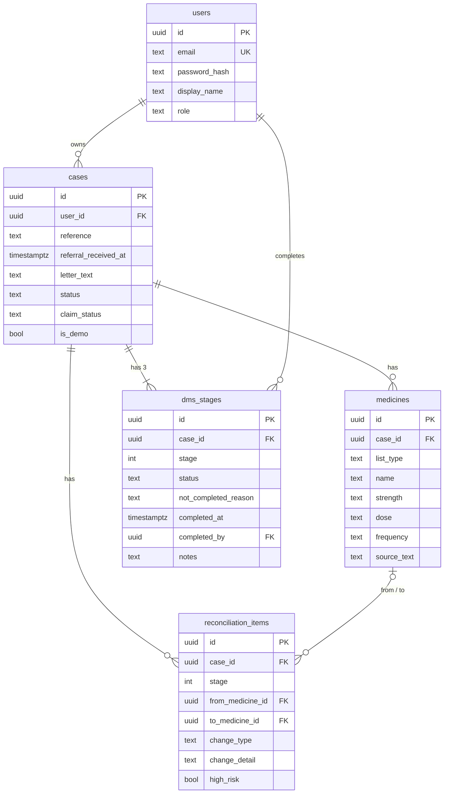

# Consult review: Claude Code's expert opinion on P1–P15

*Written 16 Nov 2026 by Claude Code (Phase 0, first session), as a senior developer working on UK healthcare
software, NHS digital standards and community pharmacy. The owner makes the final call. Once decided,
record each outcome in `docs/decisions.md` (PROPOSED → ACCEPTED / REPLACED).*

**Reality check first:** the docs say "about 2.5 weeks", but the actual build window is
**Mon 16 Nov afternoon → Tue 17 Nov 22:00 (roughly 30 working hours)**. I judged every item against that
window, not against 2.5 weeks.

| # | Topic | Verdict |
|---|---|---|
| P1 | TypeScript | **Agree**, with strict simplicity rules |
| P2 | Supabase + own API/auth | **Agree**. Use `pg` + session pooler, not `supabase-js` |
| P3 | DB access | **Agree** (plain SQL + `pg`); tiny home-made migration runner |
| P4 | Monorepo | **Agree**. Watch the shared-package build and host root settings |
| P5 | CI/CD | **Agree, trimmed**: no PR-only workflow in the sprint |
| P6 | Stage tracker | **Separate `dms_stages` table**, with a per-stage status (not just a timestamp) |
| P7 | One engine | **Agree**. Exact normalised matching, **no fuzzy matching** |
| P8 | Claim record | **Agree**. No public MYS API is live; build a copy-ready screen |
| P9/P14 | Hosting | **Agree** (Vercel + Render + Supabase). **Proxy `/api` through Vercel**. No Cloud Run in the sprint |
| P10 | Tailwind + shadcn | **Better option:** plain CSS + CSS Modules + tokens (as CLAUDE.md already says) |
| P11 | Agentation | **Disagree for the sprint.** Keep it on the "later" list |
| P12 | Vercel skills | **Skip both.** Use Lighthouse/axe instead |
| P13 | Mermaid diagrams | **Agree** (draft ERD below) |
| P15 | Missed items | Cross-site cookie trap, per-stage claiming, hazard log, NHS number guard, cut admin UI |

---

## P1 — TypeScript instead of JavaScript
**Verdict: Agree.**
- Shared Zod schemas plus `z.infer` give one definition of a medicine for the form, the API and the AI output.
  That is the strongest technical story for the panel, and it only works well in TypeScript.
- The type checker catches the kind of error AI-written code often contains (wrong field name, a value that
  might be `undefined`) before the code runs.

**Rules to keep it beginner-readable:**
1. Write explicit types on every function's inputs and return value. Let TypeScript infer local variables.
2. Never use `any`. Use `unknown` and then validate with Zod.
3. Use `type` aliases and Zod-inferred types only. No classes, no `enum` (use string unions such as
   `'started' | 'stopped'`), no hand-written generics, no decorators.
4. No non-null assertions (`value!`). Handle `undefined` explicitly with an `if`.
5. Keep one `tsconfig.base.json`, with `strict: true`, extended by the client, server and shared packages.

**Sprint risk:** low to medium. The main time sink is tsconfig and module setup, not the types themselves
(see P4).

## P2 — Supabase as host; our own Express API and auth
**Verdict: Agree. Connect with `pg`, not `supabase-js` with the service-role key.**
- `pg` plus SQL is ordinary Postgres, so it's portable and easy to explain. The service-role key bypasses all
  RLS and is a "god key": one more high-value secret with no benefit, because we don't use Supabase Auth.
- **Use the Supavisor *session* pooler connection string (IPv4).** Supabase's direct connection is IPv6-only
  on the free tier, and Render can't reach IPv6. This is a classic "works locally, fails on deploy" trap.
  Require SSL.
- **RLS:** enable it on every table with **no policies** (deny-all for `anon` and `authenticated`). Our server
  connects as the `postgres` role, which bypasses RLS, so per-user policies would **not** protect anything.
  They would also need Supabase-issued JWTs (`auth.uid()`), which we don't use. Skip per-user RLS: it adds
  complexity without protection. Our defence in depth is ownership checks in SQL (`WHERE user_id = $1`)
  plus tests. For extra safety, also `REVOKE ALL ... FROM anon, authenticated` in the first migration.
- **Pausing:** free projects pause after about a week of inactivity. A daily GitHub Actions cron (or the
  uptime ping in P9) calling `/api/health` will prevent it, as long as `/api/health` runs `SELECT 1`.

**Sprint risk:** medium. Connection strings and SSL often cost an hour on the first deploy, which is why
the Monday-night "hello world" deploy is essential.

## P3 — How the server talks to the database
**Verdict: Agree: plain parameterised SQL with `pg`.**
- It's the most explainable option ("this is the SQL, `$1` is the parameter, so injection is impossible").
  Kysely, Drizzle and Prisma each add an API to learn and a question you might not answer in Q&A.
- **Typing:** a hand-written row `type` per table, and for anything leaving the API, parse it with the shared
  Zod schema. That's simple and honest.
- **Migrations:** numbered files `db/migrations/001_init.sql`, `002_...sql` plus a ~40-line `migrate.ts` that
  records applied files in a `schema_migrations` table, each file in a transaction. It's fully explainable,
  and there's no extra tool. Use forward-only migrations (no "down" migrations in the sprint).
  - Alternative: `node-pg-migrate` or the Supabase CLI. Both are fine, but each is one more tool to set up.

**Sprint risk:** low.

## P4 — Repository structure
**Verdict: Agree: npm workspaces with `client/`, `server/`, `shared/`.**

**Pitfalls to avoid:**
1. **Building the shared package.** Make `shared` a workspace package (`@dischargeiq/shared`) whose
   `main`/`exports` point at its TypeScript source. Vite compiles it natively. Run the server in dev with
   `tsx`, and **bundle the server for production with `tsup`/esbuild**, which inlines the shared code. That
   avoids `tsc` `rootDir`/project-reference headaches.
2. **One module system:** set `"type": "module"` everywhere. Mixing CommonJS and ESM is the most common
   monorepo time-waster.
3. **One Zod version**, installed in `shared` (and the same version anywhere else).
4. **Host settings:** both Vercel and Render must install from the **repo root** (so workspaces resolve) and
   then build one package (`npm run build -w client`). Set this up in the Monday-night deploy.

**Sprint risk:** medium, but front-loaded. If it works on Monday night, it stays working.

## P5 — CI/CD from day one
**Verdict: Agree, trimmed for a 30-hour sprint.**
- **Simplest reliable setup:** one workflow running `npm ci → typecheck → lint → test → build` on every push.
  Turn on Render's **"auto-deploy after CI checks pass"** so a red build never goes live. Vercel deploys
  `main` and gives free preview deploys.
- **Don't force a PR-per-change workflow during the sprint.** Branch protection plus PRs for a solo developer
  costs real minutes per commit. Push small commits to `main`, with CI as the gate before deploy. Mention
  in the presentation that PRs and required reviews come in with a team.
- **Migrations:** run them from a GitHub Actions `workflow_dispatch` job ("Run migrations") using a
  `DATABASE_URL` repository secret. It's controlled, logged and repeatable. Render's pre-deploy command is
  paid-only. Keep migrations additive only (add columns, don't rename or drop) so old and new code both work.
- **Tests:** keep the reconciliation engine as pure unit tests (no database). For the auth and ownership API
  tests, use a **Postgres service container in CI** rather than mocks, because ownership bugs live in the SQL
  and mocks would hide them. Locally, point tests at a second free Supabase project (or Docker if installed).
- **Dependabot:** on, but weekly, and **don't merge dependency bumps during the sprint**. Secret scanning and
  push protection: on.

**Sprint risk:** low if it's set up Monday night; high if left until Tuesday.

## P6 — DMS stage tracker data model
**Verdict: Better option: a separate `dms_stages` table, with a `status` per stage.**
- Real DMS stages aren't just "done / not done". A patient may be readmitted, die, decline, never present a
  new prescription, or move pharmacy, and **each stage is paid separately** (£12 / £11 / £12). So each stage
  needs `status` (`pending | completed | not_completed`) plus a `reason` when not completed. That's three
  repeated groups of five fields, which is cleaner as rows than as 15 columns on `cases`.
- Create the three rows when the case is created, with `UNIQUE (case_id, stage)`. Queries stay simple.
- **Autosave:** use a debounced PATCH (about 800 ms after typing stops, plus on blur) sending only the
  changed fields. Show a small status: *Saving… → Saved ✓ → Couldn't save, retry*. Add a `beforeunload`
  warning while a save is pending. For conflicts, use last-write-wins (one pharmacist per case).
  `updated_at` optimistic locking can go on the "later" list. Skip optimistic UI tricks: just show the
  save state honestly.

**Clinical/product question for the owner (rule 10):** the docs assume a claim only once *all three* stages
are done. My understanding is that DMS is **paid per stage** and pharmacies can claim the stages they
completed (for example stage 1 only if the patient never presents). Please verify against the DMS
specification and Drug Tariff. It changes `claim_status` and the claims maths on the dashboard.

**Sprint risk:** low.

## P7 — One comparison engine, two uses
**Verdict: Agree. It's the best part of the design. Match on normalised name, with no fuzzy matching.**
- **Matching in Tier 1:** the match key is the **normalised generic name**: lowercase, collapse spaces, strip
  form words ("tablets", "capsules"), plus a small hand-written **brand → generic map** covering the demo
  drugs. Then compare **strength, dose, frequency, form/release (MR vs IR) and route** to decide CHANGED vs
  UNCHANGED, with a readable `change_detail`.
- **No fuzzy matching.** Look-alike, sound-alike names (hydralazine/hydroxyzine, carbamazepine/carbimazole,
  propranolol/prednisolone) are a known NHS safety hazard. A fuzzy "match" can silently pair two different
  drugs. An unmatched pair showing as STOPPED + STARTED is **safe and visible**; a wrong match is not.
- **Salts are not safe to strip blindly** (metoprolol tartrate vs succinate, diltiazem MR brands), so keep
  salt words in the key.
- **Ambiguity:** when the same drug appears twice in a list (warfarin 3 mg + 1 mg, levothyroxine 100 + 25,
  insulin morning and evening), compare as a group and, if it can't be resolved, return a
  **"needs review"** marker rather than guessing. Whether that becomes a fifth visible category is an
  owner decision.

**Edge cases the unit tests must cover:**
1. Case, whitespace and list order don't matter
2. Brand vs generic (e.g. Lipitor → atorvastatin) = same drug
3. Units: `mg`, `micrograms`/`mcg`/`µg`, `g`; 500 micrograms = 0.5 mg (and insulin "units")
4. Frequency synonyms: OD / once daily / om; BD; TDS; QDS; nocte; PRN / "when required" / "as required"
5. Same drug, different strength → CHANGED (not STOPPED + STARTED)
6. Same drug listed twice in one list
7. Missing strength in one list → CHANGED or needs review, never silently UNCHANGED
8. MR vs standard release → CHANGED
9. Combination products (co-codamol 8/500 vs 30/500) → CHANGED
10. **Once weekly vs once daily** (methotrexate) → CHANGED, and a high-risk flag
11. "Withheld / suspended / restart after…" in the letter. That isn't STOPPED. At minimum, surface the
    letter's own status for review
12. Empty lists on either side
13. Fully identical lists → all UNCHANGED

**Sprint risk:** medium. This is the core logic, so write the tests first (they double as the spec).

## P8 — Claim-ready record
**Verdict: Agree. Automation correctly stays on the production path.**
- **API check:** NHS England and NHSBSA procured a DMS API (2023) so **clinical IT systems such as
  PharmOutcomes** can send DMS data to MYS. As of the latest guidance I found (Greater Manchester LPC,
  2026), it is **not yet available**, and it's a supplier integration, not a public API. MYS also introduced
  a **shortened DMS claim journey from July 2025**. Check the owner's research and user quote against that:
  the "3 steps, progress lost" pain may be partly the old journey. That's worth knowing before the panel
  asks.
- **Format:** an on-screen summary with **one "Copy" button per field, in the same order as the MYS form**.
  Skip PDF (the browser's print-to-PDF with a print stylesheet covers it for free). A monthly CSV is a
  cheap stretch.
- **Content:** don't guess the fields. Take them from the current MYS DMS screens or guidance (likely
  referral date, referring trust, stage completion dates and outcomes). If MYS needs the patient's NHS
  number, use the 999 test range in the demo and state that in production it would come from the
  referral. Add a **"claim by" date** (the Drug Tariff claim window): unclaimed money at risk is a strong
  dashboard number.

**Sprint risk:** low.

Sources: [CPE: DMS shortened claim journey from July 2025](https://cpe.org.uk/our-news/dms-shortened-claim-journey-on-mys-from-july-2025),
[GM Community Pharmacy: DMS claims process (2026)](https://greatermanchester.communitypharmacy.org.uk/wp-content/uploads/sites/118/2026/04/Focus-on-the-Discharge-Medicines-Service-Claims-Process-.pdf),
[NHSE API Development Pharmacy DMS tender](https://bidstats.uk/tenders/2023/W36/806027429).

## P9 + P14 — Hosting (Vercel + Render + Supabase; Cloud Run?)
**Verdict: Agree with Vercel + Render + Supabase. No Cloud Run during the sprint.**
- **The biggest hidden risk in the whole plan is cookies, not cold starts.** `*.vercel.app` and
  `*.onrender.com` are different sites, so an httpOnly login cookie set by the API is a **third-party
  cookie**. Safari (iPhone) and increasingly Chrome block those, so login can "work on my laptop" and fail
  on the phone test. **Fix:** add a Vercel rewrite from `/api/*` to the Render URL. The browser then only
  ever talks to one origin, the cookie is first-party (`SameSite=Lax`, `Secure`, `HttpOnly`), CORS mostly
  disappears, and no `localhost` URLs appear in client code.
- **Cold starts:** Render free sleeps after 15 minutes idle (about 30–60 s to wake). Either (a) pay for Render
  Starter (about $7) for the demo week, which is the most reliable, or (b) use a free uptime monitor pinging
  `/api/health` every 10 minutes (one free service fits within the monthly free hours). Do (b) at minimum,
  open the app 10 minutes before presenting, and keep the backup video.
- **Cloud Run:** cold starts are better, and Secret Manager is nice, but you'd need a Dockerfile, Artifact
  Registry, IAM, a region (`europe-west2`) and billing setup. That's half a day you don't have. Put it on
  the "path to production" slide.

**Sprint risk:** high if the cookie issue is found on Tuesday night; low if it's solved in the Monday-night deploy.

## P10 — Tailwind CSS + shadcn/ui
**Verdict: Better option: plain CSS + CSS Modules + `tokens.css` (the current CLAUDE.md plan).**
- **Explainability:** shadcn components bring `cva`, `cn()`, `forwardRef`, Radix slots and Tailwind v4
  config. That's a lot of AI-generated code the owner would have to defend in Q&A, for components we
  barely need.
- **What we actually need:** a table, forms, a tracker, a small "Saved" indicator and maybe one confirm
  dialog. Native HTML covers these well and accessibly (`<dialog>`, `
`, `<table>`, a
  `role="status"` live region for autosave). The signature reconciliation view is custom in any stack.
- CSS Modules give scoped class names with zero new syntax, and design tokens as CSS custom properties are
  easy to explain: "every colour comes from one file".
- If the owner still prefers Tailwind, take Tailwind **without** shadcn, so there's less hidden code.

**Sprint risk:** adopting it now adds setup and learning time to a 30-hour window. Keeping plain CSS
needs no change to CLAUDE.md or the design skill.

## P11 — Agentation (development only)
**Verdict: Disagree for the sprint (keep it on the "later" list, as CLAUDE.md already does).**
- The canonical package is `agentation` (github.com/benjitaylor/agentation). There's also a companion
  `agentation-mcp`, which would need its own review. I've only checked its provenance; a full
  `skill-safety-check` (reading the source, network calls, dependencies) would itself take 20–30 minutes.
- The benefit is small in a 30-hour build. A screenshot plus "the red button under the stage 2 card" works
  well enough with me.
- If adopted later, load it with
  `if (import.meta.env.DEV) { const { Agentation } = await import('agentation') }` as a devDependency,
  and add a CI check that the production bundle doesn't contain the string `agentation`.

**Sprint risk:** none if skipped.

## P12 — Vercel agent skills
**Verdict: Skip both.**
- `react-best-practices` is Next.js and RSC focused, which doesn't fit Vite.
- `web-design-guidelines` overlaps `frontend-design` + `dischargeiq-design` and costs tokens and a safety
  review. **Better:** run **Lighthouse and axe DevTools** in Chrome during Phase 4. They're objective,
  free, take two minutes, and give a screenshot-able accessibility score for the presentation.

**Sprint risk:** none.

## P13 — Diagrams as code
**Verdict: Agree.** Mermaid renders on GitHub, lives in git, and changes with the code. Use one draw.io
architecture diagram for the slides. Here is a draft ERD assuming P6 = separate `dms_stages` table (move
it into `architecture.md` once the owner decides):

**Sprint risk:** none.

## P15 — Anything we've missed?

**Is the tier plan realistic?** Tier 1 plus the stage tracker is realistic in 30 hours; everything else is
optimistic. Cut, in this order:
1. **Admin UI and admin endpoints.** Keep the `role` column, but hard-code the high-risk list in a
   TypeScript file (owner-written, unit-tested). That keeps the research-backed "high-risk drugs" feature
   at roughly 1 hour instead of a CRUD screen.
2. Swagger. Replace it with a hand-written endpoint table in the README, which the marking scheme accepts.
3. Stage 2 *AI extraction* of the new prescription. Allow typing or pasting a list and reuse the same
   engine. The engine reuse is the point, not the extra AI call.
4. Then the existing cut order.

Also: 16 layouts (8 pages × 2) in about 1.5 hours means **low-fidelity wireframes**, which is fine for the
marks. Don't polish them.

**Security, privacy and clinical-safety gaps not in `architecture.md`:**
- **Third-party cookie / CSRF:** solved by the same-origin `/api` rewrite (P9), plus `SameSite=Lax` and
  JSON-only bodies.
- **Real data typed into free text** (letter, notes): add an **NHS number guard**. Detect 10-digit numbers,
  validate with the Modulus 11 check, and **reject any valid NHS number not in the 999 test range**. It's
  cheap, testable, and shows domain knowledge.
- **Prompt injection in letters:** a letter could contain "ignore previous instructions". The mitigation is
  already in the design (data-only Zod schema, no tools, the source-text check), so say so explicitly in
  the risks table.
- **AI data transfer:** in production, health data to a US API needs a DPA, zero data retention, and
  ideally a UK/EU-hosted model endpoint. Add this to the production-path slide.
- **No NHS logo or branding** in the UI. The NHS identity is restricted, and the app must not look like an
  official NHS service.
- **Login brute force:** rate-limit the auth routes (already listed), use a generic "email or password
  incorrect" message, and give the same response time for unknown emails.
- **MHRA:** "it only supports a decision" doesn't by itself take software out of medical-device scope. The
  brief already says assessment would be required. Keep that wording and don't overclaim.

**What would make it stand out to software engineers:**
1. **A mini clinical hazard log (DCB0129-style)**, about 30 minutes: 5–6 hazards (missed change, wrong match,
   hallucinated drug, wrong patient, lost autosave), each with its cause, control and **the test that
   proves the control**. Almost no bootcamp project will have this, and it ties your pharmacy background
   to engineering practice.
2. Show the **reconciliation edge-case test table** on a slide, with the green CI badge.
3. Have the "AI reads, code compares, pharmacist approves" diagram ready for the 2-minute Q&A.

**DMS workflow points to design for now:**
- Per-stage status and per-stage claiming (P6). Verify it.
- Stage 3 can be with the patient **or carer**, and may happen without the stage 2 prescription. Don't force
  a strict 1 → 2 → 3 order in the UI; allow "not completed + reason".
- The `referral_received_at` timestamp, not `created_at`, drives the 72-hour indicator. Show it as
  guidance, not a hard deadline.
- Referrals arrive mainly via PharmOutcomes and similar platforms. The production path is *receive the
  referral electronically*, not *paste the letter*. Say so on the "what's next" slide.

**Doc inconsistencies to fix later (not changed now, as requested):** `architecture.md` and `brief.md` still
say "2.5 weeks" and "feature freeze ~5 days before"; `requirements-checklist.md` lists both presentation
formats. CLAUDE.md's dates and 5 + 2 format should win.
